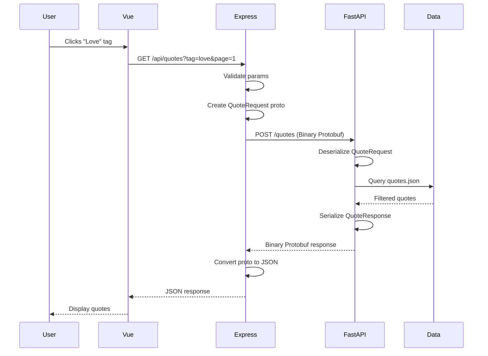

# Express + FastAPI + Protobuf

[](https://vuejs.org/)
[](https://expressjs.com/)
[](https://fastapi.tiangolo.com/)
[](https://protobuf.dev/)
[](https://www.python.org/downloads/)
[](https://nodejs.org/)
[](https://opensource.org/licenses/MIT)
[](https://ysskrishna.space)

> A reference architecture for a Quote Recommender demonstrating microservice communication between Vue.js, Express, and FastAPI using Protocol Buffers for efficient binary serialization.


## Overview

This project showcases a modern microservices architecture:
- **Frontend (Vue.js)**: User-facing web application (JSON/HTTP).
- **BFF (Express)**: Backend-for-Frontend service translating JSON to Protocol Buffers.
- **Backend (FastAPI)**: High-performance Python service handling data with binary Protocol Buffers.

**Key Highlight**: Protocol Buffers reduce payload sizes by ~30-60% compared to JSON.

## Architecture

### Data Flow



## Features

- **Microservices**: Vue 3, Express, and FastAPI communicating efficiently.
- **Binary Protocol**: Protobufs for internal communication (~60% smaller payloads).
- **Tag-based Filtering & Pagination**: Browse 2,508 quotes (loaded from [English Quotes Dataset](https://huggingface.co/datasets/Abirate/english_quotes)).
- **Developer Experience**: Hot reload across all services, `make` automation, and health checks.

## Tech Stack

- **Frontend**: Vue 3, Vite, Axios, Tailwind.
- **BFF**: Express, @bufbuild/protobuf, express-validator.
- **Backend**: FastAPI, Uvicorn, Pydantic, HTTPx.
- **Tools**: Buf, Make, uv (Python package manager).

## Prerequisites

- **Python 3.10+** - [Download Python](https://www.python.org/downloads/)
- **uv** - Ultra-fast Python package installer
  ```bash
  curl -LsSf https://astral.sh/uv/install.sh | sh
  ```
- **Node.js 18+** - [Download Node.js](https://nodejs.org/)
- **Buf** - Protocol Buffers toolchain
  ```bash
  # macOS
  brew install bufbuild/buf/buf

  # Linux
  curl -sSL "https://github.com/bufbuild/buf/releases/latest/download/buf-$(uname -s)-$(uname -m)" -o /usr/local/bin/buf
  chmod +x /usr/local/bin/buf

  # Windows
  # Download from https://github.com/bufbuild/buf/releases
  ```
- **Make** (Build automation tool)

## Quick Start

1. **Setup & Install**:
   ```bash
   # Installs dependencies (uv, npm) and generates protobuf code
   make setup 
   ```

2. **Run Services**:
   ```bash
   # Starts FastAPI (8000), Express (3000), and Vue (5173)
   make start
   ```

3. **Access**:
   - Frontend: http://localhost:5173
   - Express BFF: http://localhost:3000
   - FastAPI: http://localhost:8000

4. **Verify**:
   ```bash
   curl http://localhost:3000/health
   curl "http://localhost:3000/api/quotes?tag=love&page=1"
   ```

5. **Stop**:
   ```bash
   # Stops all running services
   make stop
   ```


## Project Structure

```text
express-fastapi-protobuf/
├── backend/
│   ├── common/proto/        # Shared Protobuf definitions
│   ├── express/             # Node.js BFF
│   │   └── src/generated/   # Auto-generated Protobuf (JS)
│   └── fastapi/             # Python Backend (contains quotes.json)
│       └── src/generated/   # Auto-generated Protobuf (Python)
├── client/                  # Vue.js Frontend
└── Makefile                 # Automation
```

## API Endpoints

| Service | Method | Endpoint | Description |
|---------|--------|----------|-------------|
| **Express** | GET | `/api/quotes` | JSON: Get quotes by tag/page |
| | GET | `/api/tags` | JSON: Get all tags |
| **FastAPI** | POST | `/quotes` | Protobuf: Get quotes |
| | POST | `/tags` | Protobuf: Get tags |

## Configuration

### Configuration Files

Each service is configured via a dedicated file. Modify these files to change ports or URLs.

- **FastAPI**: `backend/fastapi/src/config.py`
- **Express**: `backend/express/src/config.js`
- **Vue**: `client/src/config.js`

### Port Configuration

| Service | Default Port | Configurable Via |
|---------|--------------|------------------|
| FastAPI | 8000 | `backend/fastapi/src/config.py` |
| Express | 3000 | `backend/express/src/config.js` |
| Vue/Vite | 5173 | `client/vite.config.js` |

## Makefile Commands

| Command | Description |
|---------|-------------|
| `make help` | Show all available commands. |
| `make setup` | Installs dependencies (`uv sync`, `npm install`) for all services and generates initial protobuf code. |
| `make proto` | Generates protobuf code for Python and JavaScript from `backend/common/proto`. |
| `make proto-lint` | Lints `.proto` files using `buf lint` to ensure style consistency. |
| `make proto-breaking` | Checks for breaking changes in `.proto` files against the `main` branch. |
| `make start` | Starts all services concurrently (FastAPI, Express, Vue) with hot-reload enabled. |
| `make stop` | Stops all running services by killing the processes. |
| `make clean` | Removes generated protobuf files, `node_modules`, and build artifacts for a fresh start. |

## Protobuf Schema & Efficiency

**Why Protocol Buffers?**

Protocol Buffers (protobuf) is Google's language-neutral, platform-neutral, extensible mechanism for serializing structured data.

**Advantages:**
- **Smaller payload**: 30-60% size reduction vs JSON
- **Faster parsing**: Binary format is faster to serialize/deserialize
- **Type safety**: Strongly typed schema prevents errors
- **Backward compatibility**: Fields can be added without breaking clients
- **Language agnostic**: Generate code for Python, JavaScript, Go, Java, etc.

**When to use:**
- Microservice communication (internal APIs)
- High-throughput systems
- Mobile apps (reduce bandwidth)
- Long-term data storage

**Schema:**

Defined in `backend/common/proto/quote.proto`.

**Size Comparison (Example)**:
- **JSON**: `{"tag":"inspirational","page":1,"page_size":10}` (~58 bytes)
- **Protobuf**: `\x0a\x0dinspirational\x10\x01\x18\x0a` (~22 bytes) -> **~62% reduction**

## FAQ

**Q: I'm getting "Address already in use" errors.**
**A:** The ports (8000, 3000, or 5173) are likely occupied by running processes. Kill them with:
```bash
lsof -ti:8000 | xargs kill  # FastAPI
lsof -ti:3000 | xargs kill  # Express
lsof -ti:5173 | xargs kill  # Vite
```

**Q: `protoc-gen-python: program not found`?**
**A:** Ensure `buf` is installed. It manages the protobuf toolchain:
```bash
brew install bufbuild/buf/buf  # macOS
# Or download from https://github.com/bufbuild/buf/releases
```

**Q: `Cannot find module 'express'`?**
**A:** Dependencies might be out of sync. Clean and reinstall:
```bash
make clean
make setup
```

**Q: Changes to `.proto` files are not reflected?**
**A:** You need to regenerate the code after modifying schema files:
```bash
make clean
make proto
make start
```

## Built and maintained by

Express + FastAPI + Protobuf is built and maintained by:

| | Name | GitHub | Role |
|---|------|--------|------|
|  | **Y. Siva Sai Krishna** | [@ysskrishna](https://github.com/ysskrishna) | Creator |

## Support

If you find this project helpful:

- ⭐ Star the repository
- 🐛 [Report issues](https://github.com/ysskrishna/express-fastapi-protobuf/issues)
- 🔀 Submit pull requests
- 💝 [Sponsor on GitHub](https://github.com/sponsors/ysskrishna)

## License

MIT © [Y. Siva Sai Krishna](https://github.com/ysskrishna) — see [LICENSE](LICENSE) for details.

---

<p align="left">
  <a href="https://github.com/ysskrishna">Author's GitHub</a> •
  <a href="https://linkedin.com/in/ysskrishna">Author's LinkedIn</a> •
  <a href="https://ysskrishna.space">Author's site</a> •
  <a href="https://github.com/ysskrishna/express-fastapi-protobuf/issues">Report Issues</a>
</p>
